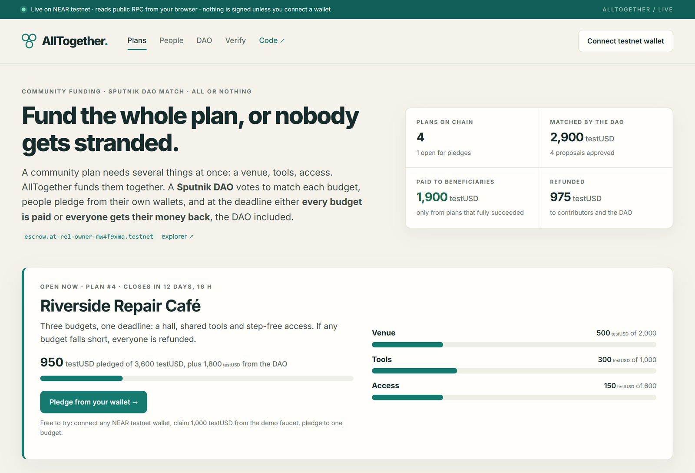
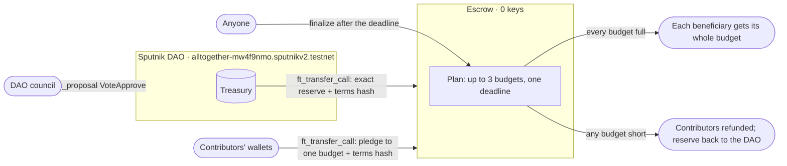
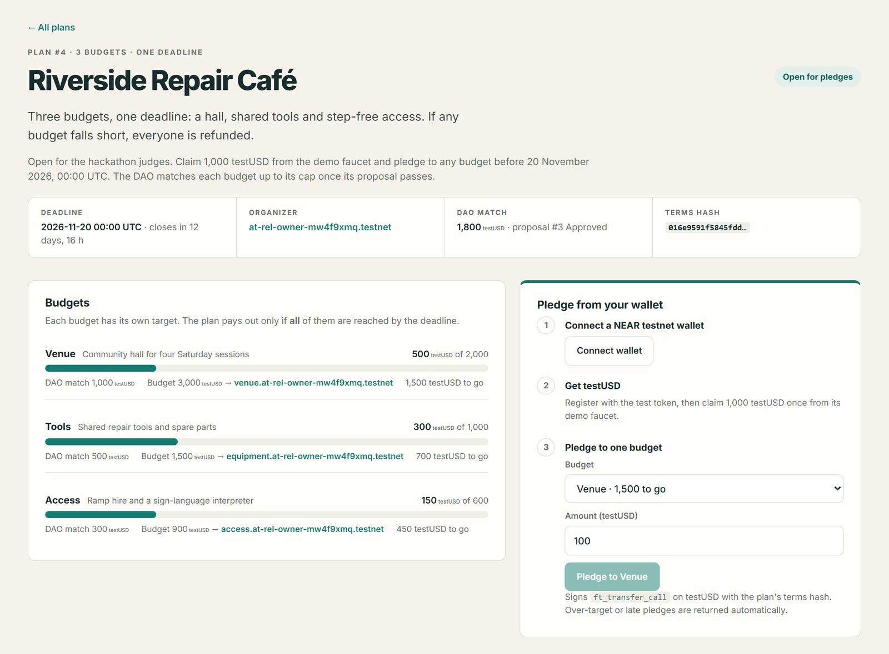
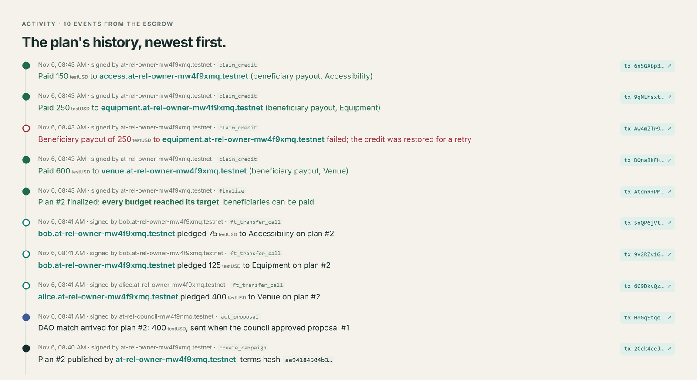
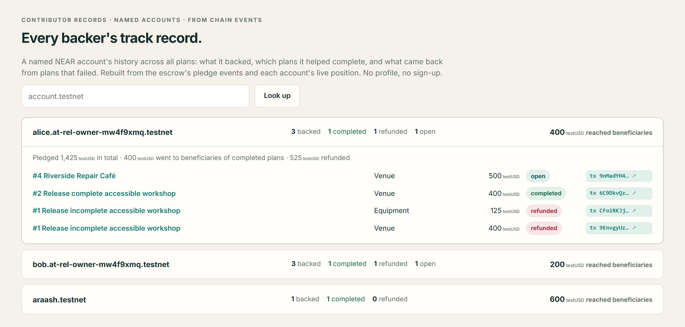
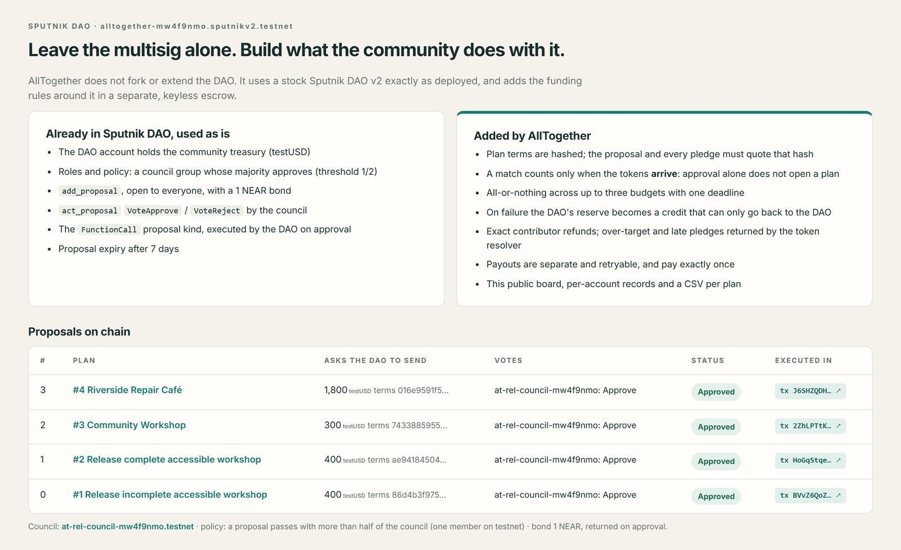

# AllTogether

[](https://github.com/aarash-mohsin/alltogether-near/actions/workflows/ci.yml)

**Fund the whole community plan, or nobody gets stranded.**

> A Sputnik DAO votes to match a community plan. People pledge from their own wallets to each of its budgets. At one deadline, **every budget is paid, or everyone is refunded**, the DAO included. The escrow and the token have no keys.

**Live page:** <https://aarash-mohsin.github.io/alltogether-live/> · **Escrow:** `escrow.at-rel-owner-mw4f9xmq.testnet` · **DAO:** `alltogether-mw4f9nmo.sputnikv2.testnet` (NEAR testnet). Plan #4 is open for pledges until 20 November 2026.

[](https://aarash-mohsin.github.io/alltogether-live/)
<sub>The <a href="https://aarash-mohsin.github.io/alltogether-live/">live page</a> reads the escrow, the DAO and every transaction from public testnet RPC in your browser. Connect any NEAR testnet wallet to pledge.</sub>

A community event needs a venue, equipment and access passes. If only the venue gets funded, the money is wasted and the people who gave it are stuck. AllTogether lets a community fund a plan made of up to three essential budgets with one deadline. Every budget has to reach its own target. If they all do, every beneficiary is paid. If any one falls short, every contributor gets their money back, and so does the DAO that offered matching funds.

Built for the **Social Money** track of the NEAR Hackathon. The matching funds come from a real [Sputnik DAO](https://github.com/near-daos/sputnik-dao-contract) on NEAR testnet, which approves them through an on-chain proposal and vote.

## Try it: do X, see Y

| Do | See |
|---|---|
| Open the [live page](https://aarash-mohsin.github.io/alltogether-live/) | The public board: 4 plans on chain, 2,900 testUSD matched by the DAO, 1,900 testUSD paid to beneficiaries and 975 refunded |
| Open plan #4, connect a NEAR testnet wallet, click **Register** then **Claim 1,000 testUSD** | Your wallet signs `storage_deposit` and `demo_faucet` on the keyless testUSD token; your balance appears in the header |
| Pledge 100 testUSD to one budget | Your wallet signs `ft_transfer_call` carrying the plan's terms hash. The budget's bar moves, you appear under **Who backed it**, and the pledge shows in the plan's history with its transaction |
| Try to pledge more than a budget still needs | The page stops you; if sent anyway, the token's resolver returns the whole amount |
| Open plan #3 | A plan published from Meteor Wallet: both budgets filled before the deadline, anyone finalized it, and each beneficiary was paid its whole budget (pledges plus the DAO match) |
| Open a plan whose deadline has passed | **Finalize** and **Pay** buttons: anyone can finalize, and each payout can only go to its fixed beneficiary |
| Open plan #1 | A plan where one budget was 25 testUSD short: no beneficiary was paid, both contributors and the DAO got exactly their money back |
| Open plan #2's history | A payout that failed (the beneficiary wasn't registered with the token), the credit restored, and the retry paying exactly once |
| Open **People** | Each named account's record: plans backed, completed, refunded, with every pledge's transaction |
| Open **DAO** | What Sputnik DAO already does and what AllTogether adds, and all 4 proposals with their votes and the transaction that executed each |
| Open **Verify**, or run `pnpm install && npm run verify` | 18 checks computed live from testnet RPC, ending `18 passed, 0 failed` |
| Run `pnpm test` | 77 application tests, including tampered-state tests that make every verify check fail |
| Run `pnpm dev`, open <http://127.0.0.1:5173> | The whole flow on a local test ledger with sample roles, plus a Live testnet workspace |

## Sputnik DAO: what already exists, what AllTogether adds

AllTogether leaves the DAO alone. It uses a stock Sputnik DAO v2 and adds the funding rules in a separate, keyless escrow.

| Already in Sputnik DAO, used as is | Added by AllTogether (`contract/src/lib.rs`) |
|---|---|
| The DAO account holds the community treasury | Each plan's terms are hashed (`terms.rs`); the DAO proposal and every pledge must quote that hash |
| Roles and policy: a council whose majority approves | A match counts only when the tokens **arrive** (`ft_on_transfer`, action `sponsor`); an approved proposal alone does not open a plan |
| `add_proposal` (open to everyone, 1 NEAR bond) and `act_proposal` votes | All-or-nothing across up to three budgets with one deadline (`finalize`) |
| The `FunctionCall` proposal kind, executed by the DAO on approval: here, `ft_transfer_call` of the exact reserve to the escrow | On failure the reserve becomes a `sponsor_refund` credit that can only be paid back to the DAO |
| Proposal expiry | Exact contributor refunds (`materialize_refund`); over-target and late pledges returned by the token resolver |
| | Separate, retryable payouts with a nonce (`claim_credit`, `on_transfer_result`) that pay exactly once |
| | The public board, per-account records and a CSV per plan (`site/`, from chain events) |



### What the hosted page shows

| A plan, and how to pledge | A plan's history from chain events |
|---|---|
|  |  |
| **Contributor records per named account** | **Sputnik flows used, and every proposal** |
|  |  |

## How it works

1. **An organizer creates a plan** with one to three budgets, a fixed beneficiary account for each, and a deadline.
2. **A community DAO sponsors it.** A Sputnik DAO proposal transfers the matching reserve into the escrow contract. Approval alone is not enough; the plan opens only once the reserve has actually arrived.
3. **People pledge** test tokens (testUSD, a NEP-141 token) to individual budgets. Overfilled or late pledges are returned automatically by the token's `ft_transfer_call` resolver.
4. **After the deadline, anyone can finalize the plan.**
   - *All budgets reached their targets:* every beneficiary gets a payment credit at the same moment.
   - *Any budget fell short:* no beneficiary is paid. Contributors get exact refunds, and the DAO gets its reserve back.
5. **Payouts are separate and retryable.** If a beneficiary's account can't receive tokens yet, the transfer fails safely, the credit is restored, and the payout can be retried later without paying twice.

The escrow is a Rust contract (`contract/`). The web app (`web/`) and API (`server/`) give each role a view of the same rules.

## See it on NEAR testnet

All accounts hold valueless test assets.

| Component | Account |
|---|---|
| Escrow contract | [`escrow.at-rel-owner-mw4f9xmq.testnet`](https://testnet.nearblocks.io/address/escrow.at-rel-owner-mw4f9xmq.testnet) |
| Test token (testUSD) | [`testusd.at-rel-owner-mw4f9xmq.testnet`](https://testnet.nearblocks.io/address/testusd.at-rel-owner-mw4f9xmq.testnet) |
| Sputnik DAO | [`alltogether-mw4f9nmo.sputnikv2.testnet`](https://testnet.nearblocks.io/address/alltogether-mw4f9nmo.sputnikv2.testnet) |

**The escrow and the token have no access keys.** Each was created, deployed and initialized in one transaction with no key added ([escrow](https://testnet.nearblocks.io/txns/2aawQQojN5pQfPr42jtDXZTfYMgadyH18uTREy55Gd2a), [token](https://testnet.nearblocks.io/txns/97yDkmrvh9amNGeD8L9Z66P8i2sW3j6EnkhLKAgzetEx)). Nobody can change their code, and the escrow has no owner or admin methods.

Four plans are on this deployment. Plans 1 and 2 were run by the release script: one failed and one succeeded. Plan 3 was published and pledged to from an external wallet (Meteor Wallet, `araash.testnet`). Plan 4 is open for pledges during judging.

Plans 1 and 2, step by step:

| Step | Transaction |
|---|---|
| DAO proposal to sponsor plan 2 | [`62Dyu3UP…`](https://testnet.nearblocks.io/txns/62Dyu3UP5QdADHD5LxsMwKTsDojKrPXjkDsDCb47kWum) |
| DAO council approves it; the matching reserve moves into the escrow | [`HoGqStqe…`](https://testnet.nearblocks.io/txns/HoGqStqefefHq5GLmPfLaEtUr9CC7wPZitPQ6WYXLFc6) |
| A pledge to plan 2 | [`6C9DkvQz…`](https://testnet.nearblocks.io/txns/6C9DkvQzfYqvjC8LzT6Q2PQfuexEJQkGwPumqZjZXxKm) |
| An overfilled pledge returned by the resolver | [`CD6cLKuf…`](https://testnet.nearblocks.io/txns/CD6cLKufN95QiVQn438NQ5ewh95qJzgxncunkGgZTCYq) |
| Plan 2 finalized as successful | [`AtdnRfPM…`](https://testnet.nearblocks.io/txns/AtdnRfPMoTq4ehnXTypfBayxxRtZHc9iCbyWPMHf8npY) |
| Payout fails for an unregistered beneficiary; credit restored | [`Aw4mZTr9…`](https://testnet.nearblocks.io/txns/Aw4mZTr9toPVVwJgkNNt1YKXDhZiw6D2pKt4voGfn45r) |
| Retry after registration pays exactly once | [`9qNLhsxt…`](https://testnet.nearblocks.io/txns/9qNLhsxtxnGp9fycqfjLrHLcD88osrDfuhti52yJKL5K) |
| Plan 1 finalized as failed | [`8jz4fuQh…`](https://testnet.nearblocks.io/txns/8jz4fuQhgRMms4ZvkpeKaXnLGi26UEJDgaGCMgQKHVAf) |
| Contributor refund paid | [`GTnRSSUc…`](https://testnet.nearblocks.io/txns/GTnRSSUcWKMomXKvKC3YYw6Yq4qDTiwFHoMpNTu3T4VB) |
| DAO reserve returned | [`GV2bAfi9…`](https://testnet.nearblocks.io/txns/GV2bAfi9KtgHK3LumPJ6eTHGAYnkgF7MauZdWhniiWmR) |

Plan 3, published and pledged from Meteor Wallet, then finalized and paid out by test accounts with `scripts/testnet-finish-plan3.mjs` (records in [`docs/qa-live-wallet-transactions.json`](docs/qa-live-wallet-transactions.json) [`docs/qa-live-wallet-dao.json`](docs/qa-live-wallet-dao.json) and [`docs/testnet-plan3-finish.json`](docs/testnet-plan3-finish.json)):

| Step | Transaction |
|---|---|
| Wallet registers with testUSD and claims the demo faucet | [`EmnktA6j…`](https://testnet.nearblocks.io/txns/EmnktA6jJW5AXJJxFumabhMGxAvDeaSkdHcnTqrz9RfE), [`2tGCPwk9…`](https://testnet.nearblocks.io/txns/2tGCPwk9HUThw3EmFAvjCwwpaEd6odQURELik1QzCnNL) |
| Wallet publishes plan 3 (two budgets) | [`Aqf6PhoM…`](https://testnet.nearblocks.io/txns/Aqf6PhoMuWvwUpivLyTpXySF8KcRtWMXJivxu4SCMzdG) |
| DAO council approves proposal 2; the 300 testUSD match arrives | [`2ZhLPTtK…`](https://testnet.nearblocks.io/txns/2ZhLPTtKVJPSMdTt7DWGE1QY12Qf7Qz9cq6JtgHzKVzd) |
| Wallet pledges 400 and 200 testUSD, filling both budgets | [`H6eJSekj…`](https://testnet.nearblocks.io/txns/H6eJSekjDgASaShMDV5GBzJkeXrRB1sb7dVwzpV2cUJz), [`7d3oh3t8…`](https://testnet.nearblocks.io/txns/7d3oh3t8kMQNo7qEvRkwGsSiDLfcvxrNMEiVfLHB8vzV) |
| After the deadline, a test account finalizes it: every budget reached its target | [`7T5HcwdM…`](https://testnet.nearblocks.io/txns/7T5HcwdMoUqdmWoBsYBUb9kNht4LqoxTG74BWAdG8kZQ) |
| A test account triggers both payouts: 600 testUSD to the venue, 300 to equipment | [`J1hcCtti…`](https://testnet.nearblocks.io/txns/J1hcCtti33PQrurSZEnJEyLtacoZBNkr9hDZwwM98BNM), [`EmPsRHi4…`](https://testnet.nearblocks.io/txns/EmPsRHi4d1Kk4qTJ4AevtZaK17bW4hou4mBaBZuyTTmp) |

Plan 4, the open judging plan (`node scripts/testnet-judging-plan.mjs`, records in [`docs/testnet-judging-plan.json`](docs/testnet-judging-plan.json)):

| Step | Transaction |
|---|---|
| Organizer publishes "Riverside Repair Café": three budgets, deadline 20 Nov 2026 00:00 UTC | [`3PKZCbaD…`](https://testnet.nearblocks.io/txns/3PKZCbaDSJcyQvN66wtQJUCZ2hcs8xsk6zYaptG5yzk5) |
| A council member proposes the DAO match (1,800 testUSD, bound to the terms hash) | [`7RLHUM9H…`](https://testnet.nearblocks.io/txns/7RLHUM9H938dU1bsCmYfD3uVHzUdnJjfxGbAPWt7DaFP) |
| The council approves; the DAO sends the reserve and the plan opens | [`J6SHZQDH…`](https://testnet.nearblocks.io/txns/J6SHZQDHyuG7DT4nQE5hYDasL6Zd1QVLq7bn4Vn3cWwH) |
| First pledges from two community members | [`9nMadYH4…`](https://testnet.nearblocks.io/txns/9nMadYH4QqdSsPosp1ba5HJrKURSvRgBJ1f2WfWzkHaa), [`EtQz3RZj…`](https://testnet.nearblocks.io/txns/EtQz3RZj6zS63vxsF4u1tBS1ooqCzkdyRxRkyxhHLnjx), [`Gzu1ygix…`](https://testnet.nearblocks.io/txns/Gzu1ygixWPHsxPyc984T3Dxq62FaA3QB1Hw1tLKaWbok) |

All 52 transactions of the release run, including the DAO's creation, are in [`docs/qa-release-testnet.json`](docs/qa-release-testnet.json), summarized in [`docs/RELEASE_TESTNET.md`](docs/RELEASE_TESTNET.md).

### Check the contract yourself

One command runs every check against the live deployment (read-only, no wallet or keys):

```sh
pnpm install --frozen-lockfile
npm run verify          # 18 PASS/FAIL lines; add --json for machine-readable output
```

It reads the escrow, the token and the DAO over public RPC, rebuilds the escrow's history from every transaction that reached it (FastNEAR transaction API), hashes the committed WASMs, recomputes every plan's terms hash, and checks each plan's DAO proposal, payouts and refunds. The [live page](https://aarash-mohsin.github.io/alltogether-live/#/verify) runs the same code (`shared/live.ts`) in the browser. Every claim is mapped to code, test and transaction in [CLAIMS.md](CLAIMS.md).

Or make the raw calls yourself. These read-only calls need no wallet. They query the public testnet RPC (`e30=` is `{}` in base64):

```sh
# Access keys on the escrow; expect "keys": []
curl -s https://rpc.testnet.near.org -H 'Content-Type: application/json' -d '{"jsonrpc":"2.0","id":1,"method":"query","params":{"request_type":"view_access_key_list","finality":"final","account_id":"escrow.at-rel-owner-mw4f9xmq.testnet"}}'

# Totals across all plans: accepted and paid principal, custody, pending transfers
curl -s https://rpc.testnet.near.org -H 'Content-Type: application/json' -d '{"jsonrpc":"2.0","id":1,"method":"query","params":{"request_type":"call_function","finality":"final","account_id":"escrow.at-rel-owner-mw4f9xmq.testnet","method_name":"get_accounting","args_base64":"e30="}}'

# All plans and their outcomes
curl -s https://rpc.testnet.near.org -H 'Content-Type: application/json' -d '{"jsonrpc":"2.0","id":1,"method":"query","params":{"request_type":"call_function","finality":"final","account_id":"escrow.at-rel-owner-mw4f9xmq.testnet","method_name":"list_campaigns","args_base64":"e30="}}'

# Deployed code hash; should be DJ73KDw8fE818kYrR9CVMztonGUnv8nn4475fpdV21pS
curl -s https://rpc.testnet.near.org -H 'Content-Type: application/json' -d '{"jsonrpc":"2.0","id":1,"method":"query","params":{"request_type":"view_account","finality":"final","account_id":"escrow.at-rel-owner-mw4f9xmq.testnet"}}'
```

`result.result` in the second and third responses is a byte array of JSON text. testUSD has 6 decimals, so `"1975000000"` means 1,975 testUSD. After the release run, `accepted_inflows` and `confirmed_paid` were both 1,975 testUSD, with nothing left in custody or pending. Plans 3 and 4 have since added their DAO matches and pledges; the escrow's token balance always equals what it owes. The deployed code hash matches the WASM committed at `contract/target/near/alltogether_escrow.wasm` (SHA-256 `b6adf23a…c5e7`); CI checks this on every push.

Earlier deployments of the same contracts, including the wallet-controller test run, are listed in the [evidence index](docs/EVIDENCE_INDEX.md).

## Run it locally

Requires Node.js 24+ and pnpm 11.25.0.

```sh
pnpm install --frozen-lockfile
pnpm dev
```

Open <http://127.0.0.1:5173>. The API runs on port 8787 and stores its data in `data/alltogether.sqlite` (set `ALLTOGETHER_DB` to use a different file). For a production build, run `pnpm build && pnpm start` and open port 8787.

The app has two workspaces:

- **Local demo.** A persistent local ledger with sample roles (Organizer, Community DAO, Alice, Bob), so the whole flow can be tried without a wallet. It is clearly labeled as a simulation; picking a role does not sign anything on chain.
- **Live testnet.** Reads the deployed contracts above and connects a NEAR testnet wallet (through [near-connect](https://www.npmjs.com/package/@hot-labs/near-connect)) to review and sign real transactions. The server never sees a wallet key.

### Try the complete flow (local demo)

1. As **Organizer**, load the sample plans or create your own. One sample uses a real three-minute deadline.
2. Request sponsorship, switch to **Community DAO**, approve the proposal, then fund the matching reserve. Approval alone does not open the plan.
3. Switch to **Alice** or **Bob** and pledge to individual budgets. Before the deadline, a pledge can be withdrawn.
4. After the deadline, anyone can finalize. If a budget missed its target, **My funds** shows the refund to claim.
5. If every budget succeeded, beneficiaries can claim. An unregistered receiver's payout fails safely; register it and retry.

`pnpm seed` loads the sample plans into a running API. `pnpm scenario` runs a short-deadline walkthrough of success, failure, refunds, a rejected overfill and payout recovery.

## Tests

```sh
pnpm test            # 77 application tests
npm run verify       # 18 live checks against NEAR testnet (read-only)
npm run build:site   # the hosted live page, into dist/site
pnpm typecheck       # strict TypeScript
pnpm build           # production frontend
pnpm test:contract   # 22 Rust tests (17 escrow + 5 token); needs Rust
pnpm build:contract  # optimized WASM; needs Rust, the wasm32 target and cargo-near
```

The tests cover concurrent HTTP requests, accounting under interleaved actions, crash recovery at three points during a transfer, and refund discovery. The results of the last full release check are in [`release-qa/RELEASE_GATE.md`](release-qa/RELEASE_GATE.md).

## Repository layout

| Path | Contents |
|---|---|
| `contract/` | Rust escrow contract (`src/`) and the testUSD test token (`test-token/`); committed release WASMs under `target/near/` |
| `server/` | Node API with SQLite storage and the read-only NEAR testnet reader |
| `web/` | React app, including the wallet controller for the Live testnet workspace |
| `site/` | The hosted live page (static, GitHub Pages): board, plan pages with wallet pledges, people, DAO, verify |
| `shared/` | Types and rules shared by the server, the app and the live page; `shared/live.ts` holds the live checks |
| `scripts/` | Dev, build, seed, backup/restore and the testnet setup scripts (`scripts/near/`, `testnet-*.mjs`) |
| `tests/` | Application, server and release tests |
| `docs/` | Design notes and on-chain evidence; start with the [evidence index](docs/EVIDENCE_INDEX.md) |
| `release-qa/` | Fresh-install, restore, dependency and browser checks |

The testnet scripts are only for creating a **new, dedicated** testnet setup. They refuse to run against mainnet or replay a completed run. Their keys are written to the ignored `.secrets/` folder and never committed.

## Known limitations

- **Testnet only**, with a valueless test token. There is no mainnet deployment, and the contracts have not had an external audit.
- **Wallet signing:** plan 3 was published and pledged to from Meteor Wallet, and the Live workspace's controller was tested through an SDK wallet adapter. The hosted page's wallet buttons make the same calls through near-connect.
- **The DAO council is a single test account**, so one vote passes a proposal. The policy and the proposal flow are stock Sputnik; a real community would add members.
- A successful plan proves the money was raised and paid out, not that the venue or supplier delivered.

## Built with

- **Contracts:** Rust, [near-sdk](https://github.com/near/near-sdk-rs) 5.30, near-contract-standards (NEP-141 / NEP-145)
- **App:** TypeScript, React 19, Vite, Node.js 24 (built-in SQLite), [near-api-js](https://github.com/near/near-api-js) 7.4, [@hot-labs/near-connect](https://www.npmjs.com/package/@hot-labs/near-connect)
- **On chain:** NEAR testnet, Sputnik DAO v2
- **AI tools:** OpenAI Codex with OpenAI's GPT-6 Astra model, used as a coding assistant for implementation and for the review passes recorded in `docs/ASTRA_*.md`.

The exact versions are pinned in `package.json`, `pnpm-lock.yaml` and `contract/Cargo.lock`.

## Development history

The project was built locally during the hackathon and put under Git only when it was published, so the first commit contains the finished work. The testnet deployments give independent dated evidence: the first deployment was made on 5 November 2026, and the current keyless one on 6 November 2026 (see the [evidence index](docs/EVIDENCE_INDEX.md) and the explorer links above).

## License

[MIT](LICENSE)
